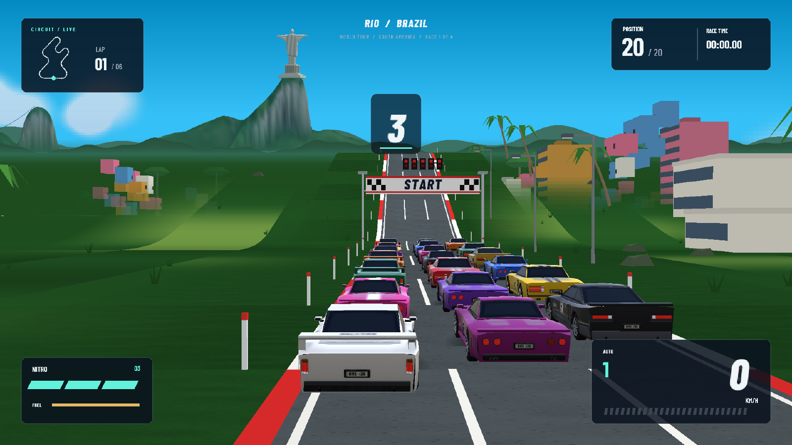
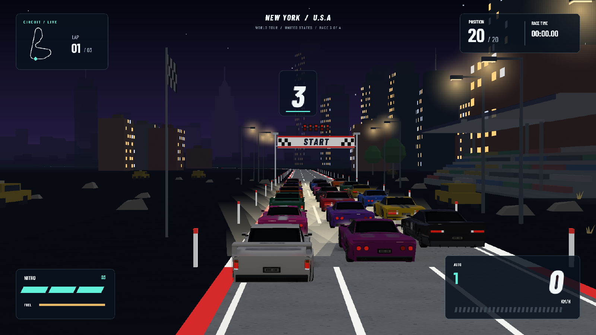
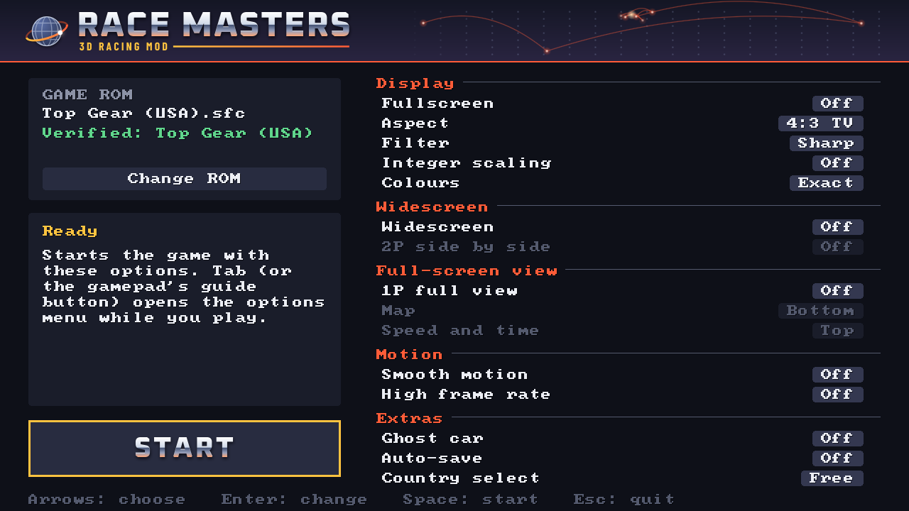
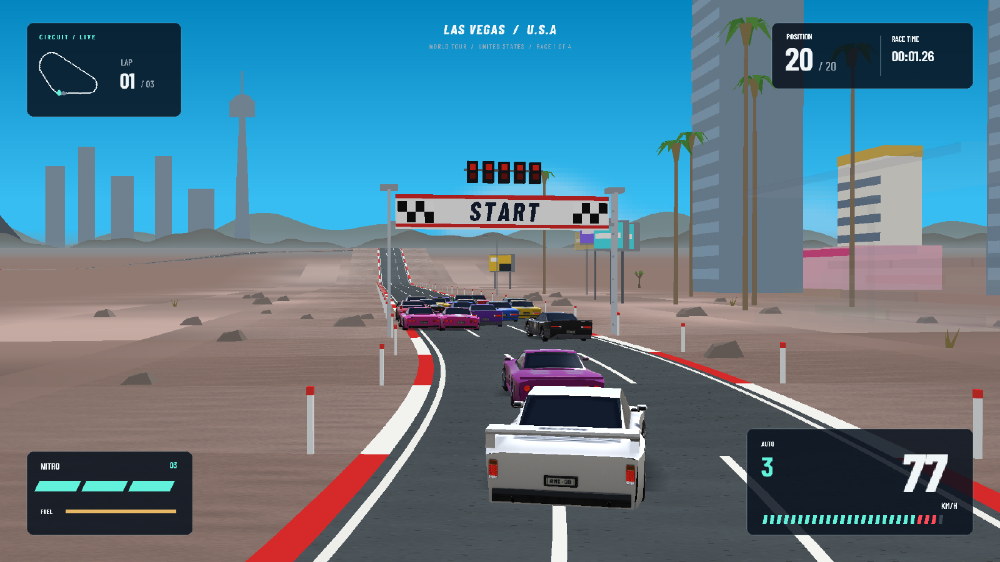

<h1 align="center">Race Masters</h1>

<p align="center">A fan-made 3D mod for the PC port of the 1992 SNES racer Top Gear: the races drawn in real 3D from the game's own state, with optional widescreen, a full-screen 1-player view, high frame rate and more.</p>

<p align="center">
  <a href="../../releases/latest/download/race-masters-windows-x64.zip"></a>
  &nbsp;
  <a href="../../releases/latest/download/race-masters-linux-x64.tar.gz"></a>
</p>

<p align="center"></p>

Race Masters is a fork of the [Top Gear SNES Port](https://github.com/thebradshaw/topgear-pc) by thebradshaw, which provides the C port, the launcher and the tools; the 3D mod is built on top of it. Thanks to thebradshaw for that work.

**To play:** download, unzip, run `race-masters-launcher`, choose your Top Gear (USA) ROM, set the options and press Start. The launcher then offers to build the optional [modern music](#modern-music-optional) on your computer.

**You need your own ROM.** The ROM isn't in this repository or its downloads: the game's graphics, sound, music and text come from your own copy, read while the program runs. The game's code is rewritten in C here and runs only alongside an unmodified Top Gear (USA) ROM:

- 524,288 bytes (a 512-byte copier header is removed automatically)
- SHA-256 `ca9889f17f184b3d99a2eaaa82af73e366f03ed00313fdd369e5e023b208e788`

A fan project, not affiliated with or endorsed by Nintendo, Kemco, Gremlin Graphics or any other rights holder. Top Gear is a trademark of its owners and is named here only to say which game this works with. See [LEGAL.md](LEGAL.md) for the details and the components' licences. Race Masters is free software under the GNU GPL v3.0 or later ([LICENSE](LICENSE)).

The downloads above are always the latest release; older ones are on the [releases page](../../releases). The Linux build is new and untested on real machines, so it may not be stable.

| | |
|---|---|
|  |  |
| New York at night | The launcher |



The screenshots show the 3D races' modern look (F7, below): the cars, scenery, landmarks and HUD are the mod's own, drawn by its code; none of the pictures in them comes from the game.

## Hotkeys

The game's own controls are the SNES pad's ([Playing](#playing)); these keys are new. The title screen shows the main ones, and the options menu has them all (Tab, then Hotkeys).

| Key | What it does |
|---|---|
| **F7** | 2D / 3D: the original picture or the race in real 3D, changing as time passing (a clock runs 1992 to 2026, or back) |
| Ctrl+F7 | 3D look: modern, the game's own pictures, or simple models |
| Shift+F7 | 3D camera: the game's, a high one, the bumper |
| **Tab** | Options menu: every setting, the controls, the hotkeys (gamepad: the guide button) |
| F11 or Alt+Enter | Fullscreen (Esc leaves it) |
| F10 | Widescreen |
| F9 | Full-screen view in 1-player races, then a tall road, then off |
| F12 | 2 players side by side (with widescreen) |
| F1 / Shift+F1 | Ghost car (race your best) / auto-save the countries you reach |
| F2 / Shift+F2 | Picture shape / frame-time log |
| F3, F4, F5 | Whole-pixel scaling, picture filter, reset |
| F6 / Shift+F6 | Smooth motion / high frame rate |
| F8 | Rumble |

## Status

Phase 3. The races run in translated C: the race program, the per-frame update, the renderer, the cars, the sprites and the raster interrupts. The menus and a few routines still run as the original game on the embedded reference emulator ([LakeSnes](https://github.com/angelo-wf/LakeSnes), MIT), which also checks the C code call by call against the original.

The C races drop the original's slowdown and loading pauses: a race updates every three frames, the original's normal pace, and loads at once. Run `race-masters.exe --original` to play the game's own code throughout, slowdown included.

## Playing

Open `race-masters-launcher.exe`, choose your ROM, set the options and press Start. The launcher works with a mouse, the keyboard or a gamepad (D-pad to choose, A to change, Start to play), remembers the ROM, and keeps the options in the same `settings.txt` as the game, so the options menu (Tab) in the game still changes them.

You can also skip the launcher: put `Top Gear (USA).sfc` next to `race-masters.exe`, or drag the ROM onto `race-masters.exe`.

| Action | Keyboard | Gamepad |
|---|---|---|
| D-pad | Arrow keys | D-pad or left stick |
| B / A / Y / X | Z / X / A / S | South / East / West / North |
| L / R | Q / W | Shoulders or triggers |
| Start / Select | Enter / Right Shift | Start / Back |

The first gamepad is player 1 and the second is player 2 (the options menu can swap them). Player 2 can also use the keyboard once you give them keys in the options menu. Controls are kept in `controls.txt` next to `race-masters.exe` (written with these defaults on first run).

| Key | Function |
|---|---|
| Tab (or a gamepad's guide button) | Options menu: every option below, the list of these keys (Hotkeys), controls for both players on the keyboard and for gamepads (press the new key or button), swapping which gamepad is player 1, colours as a TV showed them instead of exact (also `--tv-colour`), reset and quit. The game waits while it is open |
| F11 or Alt+Enter | Fullscreen |
| Esc | Leave fullscreen |
| F2 | Aspect: 4:3 TV or 8:7 square pixels |
| Shift+F2 | Frame-time log: how long each frame took, written to `recordings/` (Shift+F2 again stops it), for reporting stutter |
| F3 | Integer scaling |
| F4 | Display filter: sharp pixels, sharp-bilinear (smooth edges without uneven pixels) or scanlines (also `--filter sharp-bilinear` or `--filter scanlines`) |
| F5 | Reset |
| F6 | Smooth motion: the race updates every frame instead of every third (off by default; also `--smooth`) |
| Shift+F6 | High frame rate: on a 120 Hz or faster display, extra pictures are drawn between the game's frames, so the road, cars and roadside objects move smoothly at the display's rate (the game itself still runs at 60 frames a second). Turns on smooth motion too, and waits for the display (vsync) (off by default; also `--high-fps`) |
| F7 | 3D races (mod, `docs/3D-MOD.md`): the race drawn in real 3D, the course laid out as a 3D circuit and every car at its own place in it, from the game's own state. The modern look (the default) has new 3D models for the cars and roadside objects (cacti, trees, chevron boards, lamps), asphalt with kerbs and lane lines, a sky with a sun, shadows and distance haze; Ctrl+F7 switches to the game's own pictures and to simple models made from them (also `--3d-modern`, `--3d-pictures`, `--3d-models`). Shift+F7 changes the camera (the game's, a high one, the bumper). On by default; F7 or `--2d` for the original picture. Also in the options menu. F7 changes between the two as time passing (0.5 s, the game runs on): a clock's hand of light sweeps once round the screen, clockwise bringing the 3D view in over the original while a clock face counts the years 1992 to 2026, anticlockwise rewinding to the original (2026 back to 1992); F7 again on the way turns it back from where it is (options menu "2D/3D transition" off, or `--no-transition`, for an instant switch). 2-player races get a 3D view each (side by side with F12). The title screen comes in two styles (options menu, "Title style"; `--title-classic`, `--title-modern`): CLASSIC 3D (the default) rebuilds the original's own logo, read off the game's picture, as a solid 3D object over its sky; MODERN shows the Race Masters logo with a car. Both show the original's licence lines as its own title draws them. Needs the C code (not `--original`) |
| F8 | Controller rumble when your car hits something and when nitro fires (off by default; also `--rumble`) |
| F9 | Full-screen view: in 1-player races your view fills the whole screen instead of sharing it with the computer's. The horizon stays low and the road flat, as in the original. Press F9 again for a tall road that fills more of the screen, and again to turn it off (off by default; also `--full-view`, `--tall-road`). The same road height is used by side by side. In the options menu (Tab) you can put the map at the top or bottom left, and the speedometer and timer at the top or bottom right (`--map-top`, `--speed-bottom`) |
| F10 | Widescreen: races are drawn as wide as the window (up to 21:9), with the road, scenery and roadside objects carrying on past the original edges and the HUD moved out to the sides; menus get black borders. In a window it also switches the window between 16:9 and 4:3 (off by default; also `--wide`) |
| F12 | Side by side: in 2-player races with widescreen on, the two views sit next to each other, each the full height of the screen, instead of one above the other (off by default; also `--side-by-side`) |
| Shift+F1 | Auto-save: the countries you have reached at each skill level are remembered, so you don't need passwords after restarting (off by default; also `--auto-save`). Kept in `progress.txt` in the settings folder |
| F1 | Ghost car: in 1-player races, your best finished race on each course is replayed as a see-through car you can race against. Best races are saved as `ghosts.bin` in the settings folder (`%APPDATA%\race-masters\Race Masters`) as soon as you set one (off by default; also `--ghost`) |

Your choices for these keys are remembered between sessions in `settings.txt` in the settings folder (`%APPDATA%\race-masters\Race Masters`).

## 3D pictures: upscaled or redrawn

In 3D the cars and roadside objects are the game's own pictures. Any of them can be replaced by putting a BMP (32-bit with alpha, or 24-bit with magenta 255,0,255 as see-through) of any size in an `art3d` folder next to `race-masters.exe`. It keeps the original's place and size in the world; only its detail changes. The names:

| File | Picture |
|---|---|
| `art-<course>-<n>.bmp` | roadside object `n` of a course |
| `sky-<course>.bmp` | a course's skyline panorama |
| `car-<id>.bmp` | car `id` seen from behind (the cars of the models look, Ctrl+F7) |

The menus' photograph can be AI-upscaled: `--export-art` also writes it as `menubg-<key>.bmp`, and `tools/upscale_art.py DIR art3d/ realesrgan-ncnn-vulkan.exe` upscales it four times with Real-ESRGAN into `art3d`, where the game uses it in place of the original.

`tg_headless --shots3d 64x64 --shots-every 100000 --shots-dir . --export-art DIR/` writes the pictures of the courses it races under these names, to draw over or upscale. What the 3D view learns as you play (each course's skyline and pictures) is kept in the settings folder, so a course looks complete from the start the next time.

## Modern music (optional)

The game plays its own music, from your ROM. It can also play modern versions (Music, in the options menu and the launcher): the seven songs remade (faithful, synthwave, orchestral) and every city's tune in four styles (postcard, local band, city band, race), 149 tracks. They are arrangements of the game's compositions, so they are not in this repository or its downloads, and not hosted anywhere: **your computer makes them, from your own ROM.**

**Build music.** The first time the launcher has your ROM it offers to build them (Build now / Later / Don't ask again); any time after, press **Build music** in the launcher's Music card. Before anything is downloaded it shows what it will download, from where and under which licences, lets you choose the styles (all of them unless you untick some), and asks you to agree. For everything:

| | |
|---|---|
| Downloads, once | about 1.2 GB: free instruments from their official sources, and about 0.15 GB of tools (on Windows Python 3.12 from python.org; pip and the packages from PyPI). Your computer first reads the notes from your ROM and works out which samples they play, then downloads only those. Every file is pinned and SHA-256 checked |
| Disk | about 2.3 GB kept (instruments 1.1 GB, tools 0.5 GB, music 0.7 GB), about 4.6 GB free while it builds; "delete the libraries when it's done" keeps only the music and the tools |
| Time | about an hour on a 12-thread laptop with 16 GB (the downloads, the notes from your ROM, then the 149 tracks in about 35 minutes, several at once); longer with fewer processor cores or less memory (the launcher chooses how many tracks at once from both) |

You can play meanwhile, with the original music: Start runs the game and the launcher stays open (minimized) to look after the build, which runs at low priority. Cancel, or closing the launcher, stops it cleanly; everything done is kept, downloads too, and Build music goes on from there. If something goes wrong (no connection, a full disk) the card says what and offers Retry.

The music goes into `audio-modern` next to `race-masters.exe`, or into `%LOCALAPPDATA%\race-masters\audio-modern` if the game's folder can't be written to (the game looks in both); the tools and libraries go into `%LOCALAPPDATA%\race-masters\music-tools` (Linux: `~/.local/share/race-masters/`). Choose the music in the launcher (Sound > Music) or the options menu (Tab). Keep the files to yourself.

Windows 10 or 11 (x64) needs nothing installed beforehand except the Microsoft Visual C++ Redistributable (x64), which most PCs already have (several of the tools' packages use it); if it's missing the launcher says so, with a button to Microsoft's download. Linux needs `python3` (3.10, 3.11 or 3.12) and the libraries the synthesizer plug-ins use (Ubuntu: `sudo apt install libasound2 libfreetype6 libgl1 libx11-6 libxcursor1 libxext6 libxrandr2`). Running it by hand, the options and the details: [tools/music/README.md](tools/music/README.md).

## Recordings

Each session writes to `recordings/` next to `race-masters.exe`:

- `session-<date>.txt`: every button change from power-on. Replaying one reproduces the session exactly (`tg_headless --input <file>`, or `race-masters --replay <file>`), so recordings become regression tests.
- `coverage.tgcov`: which parts of the ROM ran or were read, accumulated across sessions. It guides the disassembly.

Run with `--no-record` to turn this off. Sessions played with `--original` can be checked call by call (`tg_headless --port verify`), so they make the best test recordings.

## Disassembly

`tools/disasm.py` turns your ROM into ca65 assembly, using the recorded coverage (`disasm/coverage.tgcov`, which keeps no bytes of the game's code) to tell code from data and to know the register widths each instruction ran with. Names and comments live in `disasm/symbols.txt`. The generated assembly comes from your ROM, so it stays local and is never committed. `tools/check_disasm.py` reassembles it and checks the ROM comes out byte-identical; with `TG_TEST_ROM` set this runs as the `disasm_roundtrip` test (needs Python 3 and cc65).

## Building

Needs CMake 3.20+. SDL3 is downloaded and linked statically, so `race-masters.exe` has no DLL dependencies. The name is set in one place, `TG_APP_NAME` / `TG_EXE_NAME` in `CMakeLists.txt` (the CMake targets are `topgear` and `topgear-launcher`; `tg_audio` is tools/audio's note reader, which the release downloads carry in `music-tools/` for Build music, `tools/package_music_tools.sh`).

Windows (Visual Studio 2022 or newer, run from a Developer Command Prompt):

```
cmake -S . -B build -A x64
cmake --build build --config Release
```

Cross-compiling for Windows from Linux (MinGW-w64):

```
cmake -S . -B build-win -G Ninja -DCMAKE_TOOLCHAIN_FILE=cmake/mingw-w64-x86_64.cmake
cmake --build build-win
```

## Tests

`ctest --test-dir build` runs the ROM-free tests. Pass your ROM to enable the ROM tests, including a two-minute attract-mode run whose RAM and picture hashes are pinned:

```
cmake -S . -B build -DTG_TEST_ROM="C:/path/to/Top Gear (USA).sfc"
ctest --test-dir build -C Release --output-on-failure
```

`tg_headless` runs the game without a window, with optional scripted input (`tools/tg_headless.c` explains the format), screenshots and hash checks.

## Layout

| Path | Contents |
|---|---|
| `src/game.c` | The game as the frontend sees it; translated C will land behind this interface |
| `src/main.c` | SDL3 frontend: window, fullscreen, scaling, input, audio |
| `src/mod3d/`, `src/gl3d.c` | The 3D mod (docs/3D-MOD.md) |
| `src/brand.h.in` | The project's name, from `TG_APP_NAME` / `TG_EXE_NAME` |
| `src/rom.c` | Loads and verifies your ROM |
| `src/launcher.c`, `src/music_build.c` | The launcher, with its Music card (Build music) |
| `tools/music/`, `tools/audio/` | The modern-music generator and the note reader it runs on your ROM (on your computer) |
| `third_party/lakesnes` | Reference emulator (MIT, see its LICENSE.txt) |
| `src/coverage.c` | Execution and data coverage of the original ROM |
| `tools/tg_headless.c` | Headless runner for tests and investigation |
| `tools/covstat.py` | Summarises a coverage file |
| `tools/disasm.py` | Coverage-driven disassembler (ca65 output) |
| `tools/covmerge.py` | Merges coverage files, e.g. from your play sessions |
| `tests/inputs/` | Input recordings replayed by the regression tests |
| `disasm/` | Symbols and accumulated coverage (no ROM content) |
| `tests/` | Tests |
| `LEGAL.md` | Not affiliated, no game data, the components' licences |
| `AGENTS.md` | Rules for contributors and coding agents: nothing from the ROM, original art from scripts, no personal data |
